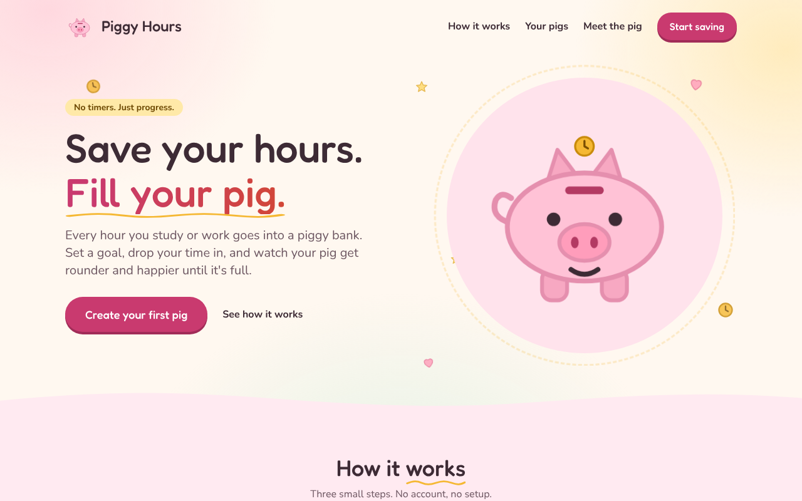
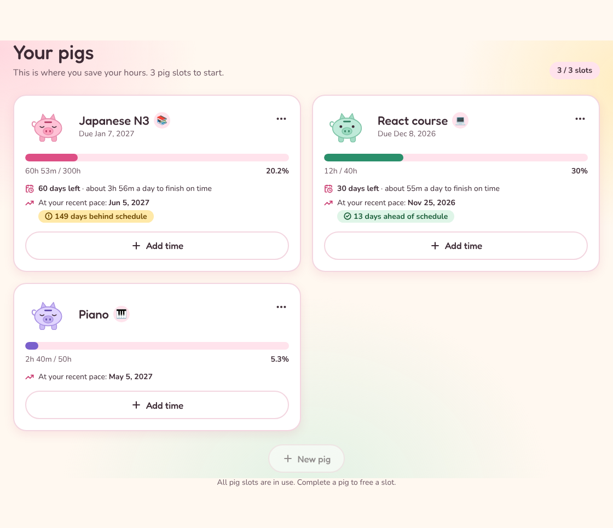
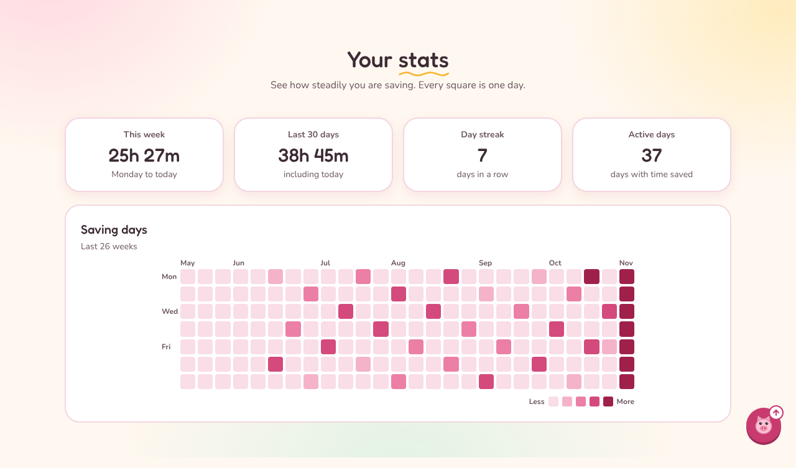
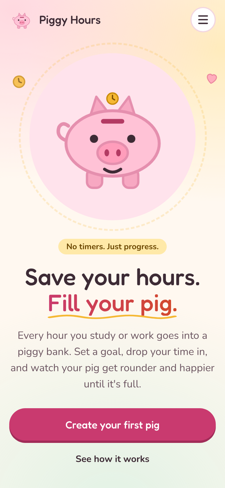
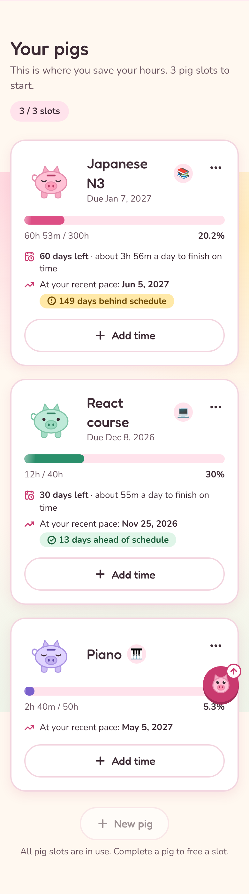

# Piggy Hours

**Save your hours. Fill your pig.**

Piggy Hours is a small web app where you drop the time you spend studying or working into piggy banks ("pigs") and watch them fill up toward a goal you set. No timers, no accounts: you add the hours and minutes after a session, and your data stays in your browser.

**Live app:** https://piggy-hours.vercel.app



| Your pigs, with deadline guidance and forecast                                                             | Your stats and saving-days heatmap                                               |
| ---------------------------------------------------------------------------------------------------------- | -------------------------------------------------------------------------------- |
|  |  |

 

## Features

- Create pigs with a target in hours; add time in hours and minutes
- Pig expressions change as it fills (sleepy to overjoyed)
- A clock drops into the pig and the pig squishes when you add time; bounce and confetti when it is full. Respects "reduce motion"; no sound
- Stats tiles and a GitHub-style heatmap of your saving days
- Edit or delete a pig, and a history of every entry you can edit or delete
- A shelf of completed pigs; completing pigs unlocks more slots
- Export and import a JSON backup, with merge or replace
- A playful look: pastel section bands, a lively hero, scroll reveals and count-up stats (all still when you prefer reduced motion)
- Deadline guidance (days left and time needed per day) and a finish-date forecast from your recent pace, with ahead, on or behind schedule
- Everything on one page, with actions in modals
- Local-first: no sign-up, data saved in your browser

Not in v1.0 (ideas for later): dark mode, installable app (PWA), share-as-image, and a 3D pig. See the [roadmap](docs/ROADMAP.md).

## Quality

- **Lighthouse (production build, mobile profile):** Performance 100, Accessibility 100, Best Practices 100, SEO 100 (see the M8 notes in [docs/TESTING.md](docs/TESTING.md)).
- **Accessibility:** keyboard operable, dialogs trap and restore focus, status never by color alone, text contrast of at least 4.5:1 on every background, reduced motion respected. An automated axe-core audit of the page and every dialog reports no violations.
- **Tests:** 323 automated tests (domain rules, state, storage, components and full user flows) run on every push.
- **Privacy:** no accounts, no analytics, no network requests with your data; everything stays in your browser and can be exported as a JSON backup.

## Tech stack

React, TypeScript, Vite, Tailwind CSS, Radix UI (dialogs), Lucide icons, canvas-confetti (loaded on demand), self-hosted Fredoka and Nunito fonts, Vitest and Testing Library, ESLint and Prettier, GitHub Actions, Vercel.

The component library is browsable at `/#design-system` (run `npm run dev`, or open the live preview).

## Getting started

Requires Node.js 20 or newer.

```bash
npm install
npm run dev        # start the dev server
```

| Script               | What it does                        |
| -------------------- | ----------------------------------- |
| `npm run dev`        | Start the dev server                |
| `npm run build`      | Type-check and build for production |
| `npm run preview`    | Preview the production build        |
| `npm run lint`       | Run ESLint                          |
| `npm run typecheck`  | Run the TypeScript compiler         |
| `npm test`           | Run tests once                      |
| `npm run test:watch` | Run tests in watch mode             |
| `npm run format`     | Format all files with Prettier      |

## Testing

Unit, component and flow tests run with Vitest and Testing Library on every push. How milestones are accepted is described in [docs/TESTING.md](docs/TESTING.md).

```bash
npm test
```

## Documentation

The project follows a lightweight software development process. All documents are in [`docs/`](docs/):

- [Project brief](docs/PROJECT_BRIEF.md)
- [Requirements](docs/REQUIREMENTS.md)
- [Decisions (ADRs)](docs/DECISIONS.md)
- [Design](docs/DESIGN.md)
- [Architecture](docs/ARCHITECTURE.md)
- [Roadmap](docs/ROADMAP.md)
- [Testing](docs/TESTING.md)

## Contributing and workflow

Work is tracked with GitHub Issues and milestones. Branches are short-lived and merged by pull request after CI passes. Commits follow [Conventional Commits](https://www.conventionalcommits.org/).

## License

[MIT](LICENSE)
